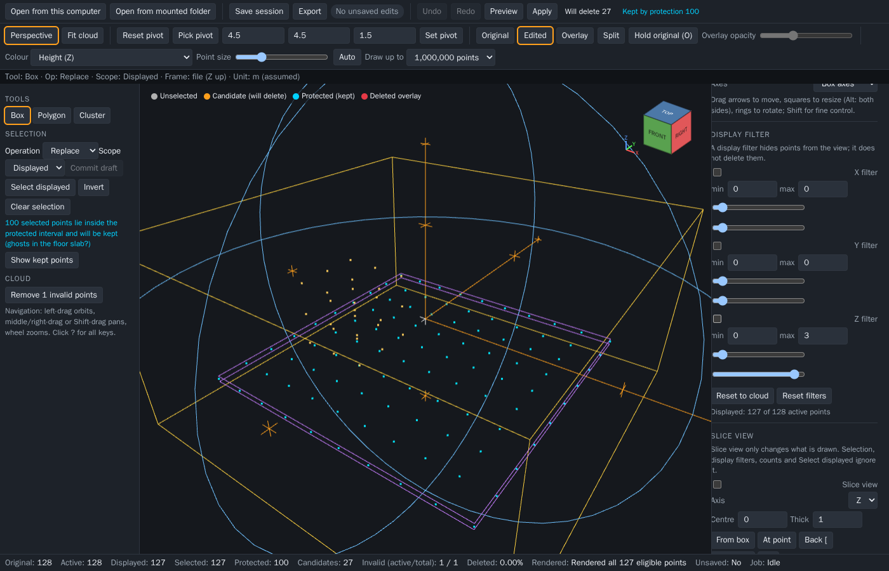

# GR PCD Editor

GR PCD Editor is a Linux-first local application for reviewing and cleaning
point-cloud (`.pcd`) maps in the browser: open a cloud, select the points you do
not want (for example reflection or ghost points), preview exactly what would be
deleted, apply, undo, compare against the original, and export a new `.pcd`.
The source file is never modified.



*A real indoor scan (about 124k points) with the tool and selection panels, slice
view, global height protection (the purple slab) and the live counts in the status bar.*

## Using the editor

1. **Open** a `.pcd` or `.pcdsession` (file picker, or drag and drop).
2. Navigate: the ViewCube or keys `1`..`6` (top, bottom, front, back, left,
   right), `P` toggles perspective/orthographic, `F` fits the cloud. The orbit
   pivot can be reset, or picked by clicking a point (Pick pivot; Esc cancels).
3. Pick a tool (**Box**, **Polygon**, **Cluster**, **Sparse points**, **Planes**, **Thin**), shape it with
   numbers or its 3D handles, and read the **exact** counts in the status bar (Selected,
   Protected, Candidates). The red **Delete** button (the `Delete` key) removes the selected
   points that are not protected; it is enabled only for an up-to-date selection.
4. **Undo/Redo** (`Ctrl+Z`, `Ctrl+Y`) walk the history. Compare with **Original**,
   **Overlay** (deleted points in red, opacity slider beside the icon while Overlay
   is on) or **Split** (original left, edited right, one camera): the four data
   modes are an icon group next to the toolbar. Comparison views are read-only.
5. **Export** (scope: active by default, displayed, or selected) or **Save session**.

| Input | Action |
|---|---|
| Left-drag | Orbit about the pivot (drags a tool handle or the rectangle when one is active; with the Box tool a drag that starts on the box moves it) |
| Box tool: drag a face arrow / a small ring on an arrow / the box body | Resize that face (Alt: both sides) / rotate the box about that arrow's axis (six rings, one per arrow) / move the box in the plane facing the camera; Ctrl+drag always orbits, also when it starts over a handle; Esc during a drag restores the box; Reset box and Reset rotation sit in the panel (there is no Axes select) |
| Box tool keys | Arrows nudge by Step (PageUp/PageDown along the view), Alt+arrows grow or shrink both faces, `,` and `.` turn by Angle step (Shift: the axis nearest screen-right; Ctrl+Shift: the view axis); Shift is a tenth |
| Middle/right-drag, Shift+left-drag | Pan |
| Wheel | Zoom |
| ViewCube (top right of the view, under the four camera buttons) | Click a face to look along that axis; click an edge or corner for a diagonal view; it follows every camera change |
| Selected colour (Selection block, left) | Four swatches (Orange, Magenta, White, Lime) set the colour of selected points on the canvas and in the legend; view only, saved with the session |
| `1` `2` `3` `4` `5` `6` | Top, bottom, front, back, left, right (the ViewCube faces) |
| `P`, `F`, `Alt+F` | Perspective/orthographic, fit the cloud, fit the camera to the current candidate |
| Hold `R`, or the **Rect** button | Rectangle select: drag a rectangle in a face view to set the box (depth: the whole cloud along the view axis) |
| Drag a filter box grip, or the arrow on its plane | Set that side of the display filter (six boxes on the canvas; Shift is finer, a typed value and a per-side reset sit in the box, the chip collapses it) |
| Arrow keys on a focused grip | Nudge the filter value (Shift finer, PageUp/PageDown ten steps, Home/End the cloud bounds) |
| Drag a protection arrow, or the band's edge | Move that side of the protected slab (open **Height protection**; the band is drawn translucent and the protected points in cyan) |
| Drag a blue ring around the slab | Tilt the protected slab about X or Y (limit 60 degrees); **Level** or the two angle fields reset or type it |
| Click a step icon in the timeline (under the view) | Highlight the points that step deleted in a distinct green (hover shows a lighter preview; click again, click the strip background or press `Esc` to clear; the legend lists **Step highlight** only while it is on) |
| Drag the timeline marker, or the **Roll back to here** button on a step (hover or focus it), or `Left` `Right` `Home` `End` on the marker | Roll the history back or forward to that point; later steps grey out and can be redone, one request is sent when you let go. **Undo** and **Redo** move the marker one slot |
| Double-click a step name, the pencil button, or `F2` on a focused step | Rename the step (an empty name restores the default label) |
| `x` button on a step, or `Delete` / `Backspace` on a focused step or on one of its buttons (the marker ignores them; they never apply) | Remove just that step after a confirmation (its points come back; later steps stay; it cannot be undone). `Enter` or `Space` highlights, arrow keys move between steps |
| `Delete` | Delete the selected points (same as the red **Delete** button, with the same confirmation for bulk deletes) |
| Click in the view with the Box tool armed | Move the box to the clicked point (a cloud point, else the horizontal plane through the box centre); a drag still orbits |
| Pencil button of the Polygon tool, then click an edge / `Backspace` over a vertex or double-click it / `Enter` or `Esc` | Polygon edit mode: add a vertex on the edge, remove the vertex under the pointer (never below three), leave the mode; dragging a vertex works with or without it |
| Click a step icon in the timeline, then **Edit shape** on the highlighted step (or `Enter` on it) | The camera centres on the step; Edit shape clears the selection and reopens the step's box, polygon, cluster or sparse shape as a live selection of its own tool (the history does not change; deleting again adds a new step; steps from older sessions have no stored shape and only centre) |
| `Ctrl+Z`, `Ctrl+Y` | Undo, redo |
| `Enter`, `Esc` | Close the polygon, cancel drawing, leave polygon edit mode, leave pick mode, discard a pending draft, close help; Esc during a grip, arrow or ring drag restores the value |
| `?` or the **?** button | Show the key list (generated from the same table the handlers use) |

The legend in the view names the highlight colours (unselected, candidate,
protected-kept, deleted overlay). Next to **Delete**, "Will delete N" and "Kept by
protection M" show the exact numbers; when M is above 0 a warning says selected
points lie in the protected interval (ghosts in the floor slab?). Add, Subtract
and Intersect shapes are drawn in their own outline colour and previewed live:
points the shape would add are drawn magenta and points it would remove blue
(the legend lists **Will be added** or **Will be removed** only while a preview is
on), and a note gives the exact counts. **Cancel upload** stops a file that is still being sent.

Concepts worth knowing:

- **Height protection is a coordinate slab**, not a semantic floor: points inside
  the protected interval are never deleted. The slab is horizontal by default; it
  can be tilted up to 60 degrees about X and Y (rings, the angle fields or **Level**)
  to follow a sloping floor, and it stays a plane, not a surface: no ramps or curves.
- A **polygon** selection includes points through the whole view depth unless its
  Z limits are enabled.
- A **display filter hides** points from the view; it does not delete them. It is
  edited with six boxes on the canvas, not panel sliders. The
  scope (Displayed or Active) decides whether a selection reaches hidden points.
- The **first selection** is live: while nothing is selected, every edit of the shape
  (a box handle, a polygon vertex, a cluster radius) replaces the selection at once and
  none of the operation icons is pressed. Choose **Add**, **Subtract** or **Intersect**
  (three icons; there is no Replace) and the next edits show a live preview of the result
  (also while you tune a Cluster's link distance, region, Exclude protected or Max points);
  the selection changes only when you press **Commit draft**; **Discard draft** or `Esc`
  drops the preview. The **Live preview** switch turns the preview off: edits then ask for
  nothing and Commit draft previews and commits once. **Delete** keeps deleting only the
  committed selection while a draft is shown, never the previewed points. Saving drops a
  pending draft.
- **Tool flow:** pressing **Cluster** arms it and waits for one click on a point; **Pick
  point** (waiting, set, paused) clears the seed and waits for another. Pressing a tool
  again, or **Clear selection**, disarms it; **Select displayed** and **Invert** refuse
  with a reason while a tool is armed. A polygon delete leaves the Polygon tool armed with
  a blank polygon. The Box tool starts as a 3 m cube.
- **Layers** (section before History) are named groups of points. **New layer** makes one from the selection,
  **Assign selection** moves the selection into the chosen row, **Release to main** and a row's **To main** give points
  back; each row has an eye (a hidden layer is not drawn, picked or selected, but stays in the cloud, the counts and
  the export), **Select**, **Edit** and **To main**. **Edit** clears the selection, opens a Box at the layer's bounds as
  a live selection; resize it and press **Set layer to selection** to make the layer hold exactly those points (points
  taken from another layer are confirmed first; the selection stays). Layers are saved in the session (version 2, version 3 when a layer step exists), restored on reopen, and the Export dialog can export a subset of layers. Layer edits are steps in the timeline: Ctrl+Z
  undoes them and the Export dialog can write one file per layer. **New layer from protected points** snapshots the height band into a protected layer called
  Floor. The chevron on a row opens its menu: rename, 16 colours, Visible, **Protected** (its points are never deleted
  by any Delete; Override protection frees only the band), **Lock** (no points move into or out of it), Select, Add,
  Subtract and Intersect with the layer, Up and Down, Merge into another layer and **Delete points**. The colour
  control has a **Layers** entry (layer colours, main in grey) while layers exist.
- **Hide selected** (Selection section, after Clear selection) moves the selected points into the layer **Hidden** and
  hides it; the button then reads **Show hidden (N)** and a **N hidden - Show** chip appears in the legend. Hidden
  points are not drawn, picked or selected (Select displayed, Invert and Delete leave them alone), but they stay in the
  cloud and **Export** contains them. Unlike the earlier view-only version it is saved with the session.
- **Sparse points** selects points with fewer than a set number of neighbours (default 8)
  within a small cube around them, so isolated artifacts in the open go while dense walls
  and floors stay. The radius (default 0.4 in the file unit; empty: derived from the point spacing), the region (whole
  cloud, box or polygon) and Exclude protected are set in its panel; it is an ordinary
  selection tool and composes with Add, Subtract and Intersect. The neighbour count is an
  upper-bound proxy for a true radius count, and its quality on a real scan is for you to judge.
- **Planes** finds floor and ceiling candidates: Detect lists up to Max planes near-horizontal planes (default 1, at most 8; tilt at most 5 degrees
  and Distance 0.1 by default) (lowest first, with their
  point counts); choose a row to select the points within the Distance of that plane, or **Use as protection band** to
  protect a tilted floor. Detection changes nothing by itself.
- **Thin** selects duplicate points (distance 0 for exact copies, above 0 for near copies) or a voxel subsample; Delete
  then removes them and Undo brings them back. The point with the lowest index in each group stays. Both tools follow
  published algorithms (RANSAC plane fitting, voxel grid downsampling) and contain no CloudCompare code.
- The unit is a label only (metres, assumed); the file frame is used as stored, Z up.
- Counts in the status bar are exact; "Rendered" is the sampled number of points
  drawn and is never a cloud total.
- The app warns before leaving the page while there are unsaved edits. The
  `.pcdsession` download stores the edits and the view; reopen it with **Open**.
- By design the view state (camera, which inspector sections are folded, tool settings) lives in the server's session
  and is restored when the page loads while that session is still open, so a fresh browser tab shows the folds of the
  session it attaches to. Opening another file starts a new session. Save flushes any pending view change first, so the
  archive carries the current folds and camera.

## Prerequisites

- Linux
- Docker Engine
- Docker Compose v2

## Running

Clone the repository and run:

```sh
./gr-pcd-visualizer.sh                      # port 8080
./gr-pcd-visualizer.sh --port 8081
./gr-pcd-visualizer.sh --rebuild            # rebuild the image, keep work data
./gr-pcd-visualizer.sh --no-browser         # do not open a browser
./gr-pcd-visualizer.sh --stop               # stop; work data is kept
```

The launcher builds the image on first use, waits up to 120 s for the app to
report healthy (override with `GR_PCD_WAIT_TIMEOUT=<seconds>`), then prints
`GR PCD Editor is ready: http://localhost:<port>` and opens your browser. It
never prints that line before the health check passes. The server listens on
`127.0.0.1` only. `--stop` stops this project's container without deleting
exports or the persistent `work` volume.

One instance per checkout. Running the launcher again with the same settings
reuses the running app. Different `--port` or user is refused
(exit 5); run `./gr-pcd-visualizer.sh --stop` first. `COMPOSE_PROJECT_NAME`
selects a separate instance. Upgrading from an earlier build: run
`./gr-pcd-visualizer.sh --rebuild` once (a container that still has the old
data-folder mount is recreated). A leftover `--data-dir` in a shell alias now
exits 2.

The container runs as your user id; that matters only for the `work` volume.
If you are root, it runs as uid 10001 and warns. A `work` volume created by an older image is owned by uid
10001. The app copes with sub folders left by another uid (it uses `uploads.u<uid>` and so on next to them).
If it still reports that it cannot write `/work`, remove the volume
yourself with `docker volume rm gr-pcd-visualizer_work` (this deletes
uploads and session working data; the launcher never does it).

| Exit | Meaning |
|---|---|
| 0 | ready / stopped |
| 1 | startup failed or health timed out (logs printed) |
| 2 | bad flag or port (`--data-dir` was removed) |
| 3 | Docker CLI, Compose v2, daemon or local context missing |
| 4 | port in use |
| 5 | running instance has different settings |
| 130 | interrupted (the server may still run; use `--stop`) |

## Files, exports, and troubleshooting

**Open** takes a PCD or a saved session (`.pcdsession`) from the browser's
file picker or by drag-and-drop, from any folder the browser can read. The file
is uploaded only to this loopback app, with progress and a Cancel while bytes
are being sent. The app has no access to your folders: nothing is mounted into
the container. A replacement import never clears the
current session until it succeeds, and unsaved edits need an explicit replace.

**Export PCD** downloads `<original>_cleaned.pcd` and **Save session**
downloads `<original>_session_v1.pcdsession` (`v1` is the session format
version). Both are browser downloads: the browser or operating system selects
the destination and may show a save dialog, the app never overwrites the
original path, and "server finished" does not prove "browser saved". The
original input PCD is never modified.

Temporary uploads, exports and session archives live in the `work` volume and
are removed on startup and after one hour (never the live session's data).
Files above the size limit (16 GiB by default, `GR_PCD_MAX_SOURCE_BYTES`) fail
with a message naming the limit; "storage full" means the work volume lacks
space (a reserve of `GR_PCD_UPLOAD_RESERVE_BYTES`, 256 MiB, is kept free).
`/api` answers only to `localhost`, `127.0.0.1` and `[::1]` on the configured
port (`GR_PCD_PUBLIC_PORT`, set by the launcher from the chosen port); other
Host or Origin values are refused.

## Measured limits

The container runs with a memory limit (`GR_PCD_MEM_LIMIT`, default `6g`, no
swap beyond it), 256 processes and an init process; the default import budget
is 60 % of the smaller of the limit and the host's available memory. A running
operation that nears 85 % of the limit is stopped with a `memory_guard` message
and the session survives. Cluster growth (cell-level search, memory bounded by
chunk caps, not by point density) on the synthetic room scene on the checks
image: 331k points in 0.5 to 1.3 s and at most 315 MiB for radius 0.5 to 5; 993k
points at radius 0.5 in 2.7 s and 177 MiB peak (radius 2: 5.9 s, 422 MiB);
cancel is observed within 10 ms. These are guarded by `CLU-40..43`; a real
machine and a real scan will differ. A radius so small that the cloud needs more
than 2^20 cells per axis is refused with the minimum radius to use.

Binary export is bit-exact. ASCII export writes float32 fields with nine
significant digits after a 64-bit read, so a value can differ from the source
text in the last digit while still round-tripping to the same float32.

A Docker named volume `work` holds uploads, caches and session working data
and survives stop and rebuild. Unsaved in-memory editing state is lost when the
container stops; downloads you saved are never removed.

If Docker, Compose, the Docker daemon, or the requested port
is unavailable, the launcher explains the corrective action and
exit without claiming success.

## Verification

These Linux commands work now:

```sh
docker compose -f docker/compose.yaml --profile checks build verify lint
docker compose -f docker/compose.yaml --profile checks run --rm verify
docker compose -f docker/compose.yaml --profile checks run --rm lint
```

The container tier (needs Docker) and the bootstrap contract:

```sh
bash tests/container/test_compose.sh
bash tests/launcher/test_launcher.sh          # stub docker, no daemon
bash tests/launcher/test_launcher_smoke.sh    # real Docker, port 18081
bash scripts/check-bootstrap-contract.sh
```

Browser smoke (real headless Chromium through the real UI; needs network once
to pull the Playwright image):

```sh
bash scripts/smoke.sh                           # runs e2e/smoke.spec.ts
SMOKE_UPDATE_SCREENSHOT=1 bash scripts/smoke.sh # also refreshes docs/images/editor.png
```

### Manual checklist: real GPU and a 1,000,000-point cloud

The smoke runs on software WebGL (SwiftShader) with small synthetic clouds, so
these checks are manual, on a real browser with a GPU and a private map you own:

- [ ] Open a cloud of about 1,000,000 points; orbit, pan and zoom stay smooth.
- [ ] While the camera moves the view draws at most 150,000 points (plus the selected ones) and the full draw returns 250 ms after you stop; write down the frame rate while orbiting and when idle: ______ / ______ fps.
- [ ] Draw budget 1,000,000 and Auto (max): the status bar says "(sampled to budget)" and the frame rate is acceptable.
- [ ] Box, rectangle and polygon previews follow the drag without stalls; Apply is exact.
- [ ] Pick floor point, then Apply: floor points survive and ghosts above the slab go.
- [ ] A step click centres the camera on its points, and a Box click moves the box to the clicked point.
- [ ] The ViewCube and `1`..`6` agree; the help overlay (`?`) lists every key.
- [ ] 1280x720 and 1920x1080 windows: no horizontal scrollbars in the side panels.
- [ ] Export, reopen the exported PCD in your viewer, and compare the point count.

## Point cloud loaded

The screenshot at the top shows a **synthetic** cloud generated in code
(`e2e/synthetic.ts`); no private map is committed.
